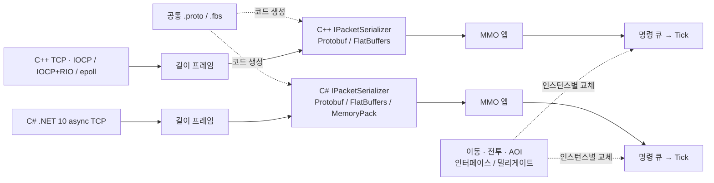

# Helix Engine

**C++20과 순수 C#으로 각각 빌드하는 서버 엔진과 MMO 인스턴스 모듈.**
사용자는 공개 핸들러를 구현하고 설정 파일로 서버를 구성한다. C++은 Windows IOCP·IOCP+RIO와 Linux epoll, KCP 전송 및 Redis 백플레인을 제공한다. C#은 네이티브 DLL 없이 동작하는 .NET 10 TCP 엔진이다.

```powershell
git clone https://github.com/Kangpg/Helix-Engine.git
cd Helix-Engine
```

빌드에는 CMake 3.21 이상과 C++20 컴파일러(Windows: Visual Studio 2022 C++ 도구), C#에는 .NET 10 SDK가 필요하다. Python 검증 도구는 Python 3.10 이상을 사용한다. 기본 프로토콜의 첫 빌드는 고정 버전 의존성을 다운로드하므로 네트워크 연결이 필요하다.

## 저장소 안내

| 경로 | 내용 |
|---|---|
| `include/helix/`, `src/` | C++ 공개 SDK와 내부 엔진 구현 |
| `cpp/` | 독립 C++ 빌드, MMO·프로토콜 모듈, 테스트·벤치마크 |
| `csharp/` | 독립 C# 엔진·MMO·프로토콜, 샘플·테스트 |
| `protos/`, `config/` | 공통 메시지 스키마와 서버 설정 |
| `samples/`, `tests/`, `tools/` | C++ 샘플, 네이티브 테스트, 검증·측정 도구 |
| `docs/` | 사용·설계 문서와 Phase 기록 |

[문서 안내](docs/README.md) · [빌드·검증](docs/BUILD.md) · [MMO 조립](docs/MMO.md) · [C++ 병렬 월드](docs/PARALLEL_MMO.md) · [직렬화 계약](docs/SERIALIZATION.md) · [코드 지도](docs/CODE_MAP.md) · [개발 계획](HELIX_ENGINE_PLAN.md) · [테스트 GUI](tools/gui/README.md)

빌드 출력, 복원한 의존성, NuGet 패키지 및 실행별 벤치마크 결과는 Git에 포함하지 않는다. 아래 `build/`·`out/` 경로는 해당 명령을 실행하면 생성된다.

## 개발 핵심 목표 및 특징

- **공개 SDK**: 서버 핸들러와 공개 API로 앱을 작성하며 저수준 플랫폼 타입은 내부에 둔다.
- **전송과 직렬화 분리**: 엔진은 프레이밍된 바이트를 전달하고 앱에서 메시지 codec을 주입한다.
- **확장**: C++ Redis 세션 라우팅과 선택 병렬 월드로 노드 간 전달 및 한 월드 내부 병렬 처리를 실험한다. 운영 수용 인원을 보장하는 것은 아니다.
- **독립 엔진**: C++과 C#을 따로 빌드·실행한다. C ABI는 C++의 선택 빌드다.
- **외부 설정**: 파일과 환경변수로 튜닝값을 지정하고 기동 시 검증한다.
- **검증**: 변경한 계약에 맞는 테스트·실제 통신·동일 조건의 성능 측정을 구분해 기록한다.

## 퀵 스타트

```cpp
#include "helix/helix.h"

class UserServer : public helix::IServerApp {
    void OnMessage(helix::Session& s, helix::ByteSpan msg) override {
        s.Send(msg);
    }
};

int main() {
    return helix::Server::LoadConfig("config/helix.toml").Run(std::make_unique<UserServer>());
}
```

## 전송 선택 가이드

| 워크로드 | 권장 전송 | 이유 |
|---|---|---|
| MMO, 턴제, 일반 서버 | **TCP**(기본) | 순서·신뢰 전달을 제공하는 기본 경로 |
| 액션 MMO / 고틱레이트 / FPS / MOBA | **KCP**(C++ 선택) | 신뢰 UDP 경로. 실제 지연·손실·대역폭 조건에서 비교 필요 |
| 모바일(망 전환 잦음) / TLS 내장 / 채널 분리 | QUIC(예정) | 연결 마이그레이션, TLS1.3, 스트림 멀티플렉싱 |

## 빌드

C++과 C#은 독립 엔진 프로젝트다. C#은 `helix.dll` 없이 실행한다.
C# 엔진·샘플·테스트·별도 benchmark는 `net10.0`을 사용한다. 루트 `global.json`은 안정 .NET 10 SDK의 최신 feature band를 선택하며 .NET 11/preview로 넘어가지 않는다. 관리 NuGet 0.4.0은 .NET 10 이상 소비자를 대상으로 한다. 이전 0.2.0의 net8 산출물·측정 및 0.3.0 패키지 이력은 보존한다.

```powershell
cmake --preset windows-x64
cmake --build --preset windows-debug
ctest --test-dir build/windows-x64 -C Debug --output-on-failure
```

C++ 프로젝트만 구성할 때는 `cmake -S cpp -B build/cpp -G "Visual Studio 17 2022" -A x64`를 사용한다.
C ABI 공유 라이브러리는 필요한 소비자가 있을 때 `-DHELIX_BUILD_CAPI=ON`으로 켠다.
기본 빌드는 `Helix.Protocol`도 만든다. Protobuf 36.2와 같은 버전의 공식 protoc를 자동 복원하고 C++ 생성 코드를 빌드 디렉터리에 만든다. C++ compiler/runtime의 정확한 버전을 맞춘다. 기본 빌드는 선택 FlatBuffers adapter도 제공하며 flatc 25.2.10을 지정하거나 고정 upstream source에서 빌드한다. `-DHELIX_BUILD_FLATBUFFERS=OFF`로 adapter만 제외할 수 있다. 코어/기존 오프라인 MMO만 필요하면 `-DHELIX_BUILD_PROTOCOL=OFF -DHELIX_BUILD_PARALLEL_MMO=OFF`로 외부 의존성 복원을 제외한다. 병렬 MMO는 Protocol OFF에서도 Taskflow를 복원한다. C# 프로토콜은 Google.Protobuf 3.36.2와 빌드 전용 Grpc.Tools 2.84.0을 사용한다.

```powershell
dotnet build csharp/Helix.sln -c Release -m:1
dotnet run --project csharp/samples/Helix.Echo -c Release -- config/helix.toml
```

## MMO 인스턴스 조립

- C++: `cpp/Helix.Mmo`, C#: `csharp/Helix.Mmo`.
- `WorldInstance`에 `IMovementPolicy`, `ICombatRules`, `IVisibilityPolicy`를 주입한다. 각각 델리게이트 어댑터도 제공한다.
- `QueueMove`/`QueueAttack`은 상태 변경을 예약하고 `Tick`이 실행한다. `ReplaceMovement`/`ReplaceCombat`/`ReplaceVisibility`는 다음 tick 시작에 반영한다.
- 조회는 불변 스냅샷이며, AOI 규칙과 데이터는 같은 tick에 고정된다. 이동/전투 구현은 월드 상태를 직접 수정하지 않는다.
- 실행 한도와 주기는 `config/helix.toml`의 `[mmo]` 및 `HELIX_MMO__*`로 설정한다.

```powershell
./build/windows-x64/Debug/helix_world_server.exe config/helix.toml
# 또는 독립 C# 서버
dotnet run --project csharp/samples/Helix.WorldServer -c Release -- config/helix.toml
# 기동한 MMO 샘플의 이동·전투·AOI 검증
python -m pip install --target build/protobuf-python -r tools/requirements-protobuf.txt
python tools/generate_protocol.py
python tools/world_bot.py --port 5000
```

두 언어의 테스트 출력까지 빌드한 후 `python tools/verify_engines.py`로 TCP echo/churn과 MMO 공통 시나리오를 검증한다. 로컬 테스트 서버만 생성·종료한다.

현재 C# 구현은 TCP/로컬 세션 범위다. KCP·Redis·TLS 및 대규모 MMO 최적화는 아직 동등 구현이 아니다. 기본 C++/C# `WorldInstance` 샘플의 AOI는 같은 인스턴스의 모든 엔티티를 반환한다. QUIC은 후순위다.

### C++ 작업 그래프 병렬 월드 (선택 실험)

`ParallelWorldInstance`는 한 전장의 이동·피격 판정·서로 다른 대상의 HP 반영을 여러 worker가 실행한다. Taskflow 4.1.0은 공개 API 뒤의 실행기이며 여러 월드가 한 pool을 공유한다. XZ 공간 인덱스로 후보를 찾고 XYZ 거리로 AOI를 검사한다. 기본 빌드 옵션은 OFF, 기본 실행은 기존 `sequential`이다.

```powershell
cmake --preset windows-x64 -DHELIX_BUILD_PARALLEL_MMO=ON
cmake --build --preset windows-release --parallel 8
ctest --test-dir build/windows-x64 -C Release --output-on-failure
$env:HELIX_MMO__EXECUTION="parallel"
$env:HELIX_MMO__WORKER_THREADS="4"
./build/windows-x64/Release/helix_world_server.exe config/helix.toml
# 서버 종료 후 이 터미널을 기본 실행으로 되돌릴 때
Remove-Item Env:HELIX_MMO__EXECUTION, Env:HELIX_MMO__WORKER_THREADS
# C# 빌드 없이 두 native 모드의 실제 통신 확인 (Python Protobuf 준비 후)
python tools/verify_parallel_world.py --backend iocp_rio
# 빌드·통신 검증이 끝난 뒤 동일 단계 규칙의 순차/병렬 비용 측정
python tools/parallel_world_benchmark.py
```

새 월드는 추가/제거 → 이동 → 피격 판정 → 대상별 반영 순서이며 기존 명령별 순차 처리와 게임 의미가 다르다. 정책은 순수·결정적·동시 호출 안전이어야 한다. AOI 조회와 응답 직렬화는 호출 스레드에 남아 있다. C#에는 이번 병렬 구현을 추가하지 않았다.

2026-11-03 Windows Release 검증에서 전체 CTest 6/6, 독립 C++ 4/4와 실제 IOCP/RIO 통신을 통과했다. 4,096엔티티·3회 측정에서 inline과 worker 1/2/4/8의 결과는 일치했지만 **현재 단순 전투 규칙에서는 성능 개선을 확인하지 못했다**. [단계별 계약·설정·라이브러리 비교·측정표](docs/PARALLEL_MMO.md)를 참고한다. Linux·원격 CI·운영 규모 부하는 미검증이다.

## 직렬화 선택과 메시지 호환

`[protocol] serializer="protobuf"`가 기본이다. `HELIX_PROTOCOL__SERIALIZER=flatbuffers`로 서버를 선택하고 클라이언트도 같은 codec을 선택하면 공통 FlatBuffers를 사용한다. C#끼리는 `memorypack`도 선택할 수 있다. `WorldApp`은 공통 메시지 DTO와 좁은 `IServerPacketSerializer`에만 의존한다. 클라이언트 역할은 `IClientPacketSerializer`로 분리하고 adapter가 두 역할의 `IPacketSerializer`를 구현한다. 새 codec은 registry factory 등록으로 추가한다.

| 포맷 | C++ ↔ C# | C# ↔ C# |
|---|---|---|
| Protobuf | 지원 · 기본 · 기존 wire 유지 | 지원 |
| FlatBuffers | 지원 · 공통 `.fbs` | 지원 |
| MemoryPack | 미지원 | 지원 · VersionTolerant |

송수신자는 같은 포맷을 선택해야 하며 포맷 사이의 바이트 호환이나 실행 중 자동 협상을 뜻하지 않는다. 포맷/버전 불일치는 거부한다. [주입 코드·wire·버전 규칙](docs/SERIALIZATION.md)을 참고한다. C# 선택 모듈은 `Helix.Protocol.FlatBuffers` / `Helix.Protocol.MemoryPack`, C++은 `helix::protocol_flatbuffers`다. 기본 Engine/Mmo는 직렬화 라이브러리에 의존하지 않는다.

## Windows TCP 백엔드

Windows TCP는 `backend="iocp"` 또는 `backend="iocp_rio"`로 선택한다. `auto`는 일반 IOCP다. 하이브리드는 IOCP의 AcceptEx/완료 알림과 RIO의 등록 버퍼·송수신 큐를 조립한다. 명시적 RIO 초기화 실패는 기동 실패로 보고하며 조용히 IOCP로 바꾸지 않는다. `[rio] buffer_size`는 컨텍스트별 등록 버퍼 크기, `completion_queue_size`는 `2 * max_connections` 이상이다. RIO는 Windows C++에만 적용하며 C#은 async TCP다.

```powershell
$env:HELIX_NETWORK__BACKEND="iocp_rio"
./build/windows-x64/Debug/helix_world_server.exe config/helix.toml
# 실제 모드와 공통 샘플 검증
python tools/verify_engines.py --native-backend iocp_rio
```

RIO는 현재 staging copy를 사용하며 컨텍스트별 버퍼를 재사용한다. 등록 버퍼는 완료 회수 뒤 해제하며 큰 송신은 부분 송신을 이어간다. Windows 종료는 소켓 취소 후 세션과 AcceptEx가 배수될 때까지 I/O 소유자를 보존한다. drain_timeout_ms를 넘으면 경고하고 안전한 회수를 계속하므로 강제 종료 deadline이 아니다.

## 직렬화 성능 비교

기본 운영 wire는 Protobuf를 유지한다. 선택 직렬화 adapter는 [직렬화 계약](docs/SERIALIZATION.md)에 있고 아래 benchmark는 별도 DTO의 측정이다. 새 adapter의 envelope·verifier·VersionTolerant 비용을 포함한 측정은 아니다. C#은 Protobuf·MessagePack·MemoryPack·JSON·FlatBuffers·Binary, C++은 Protobuf·FlatBuffers·Binary를 비교한다. 같은 월드 상태/AOI 배열 0·16·256·4096개로 encode/decode를 분리하고 크기·시간, C#은 관리 할당량도 기록한다. 전체 객체/배열 복원을 비교하며 FlatBuffers view-only 조회와 혼합하지 않는다.

```powershell
dotnet run --project csharp/benchmarks/Helix.SerializationBenchmarks -c Release -- --quick
# BenchmarkDotNet 정식 측정 (시간이 더 필요)
dotnet run --project csharp/benchmarks/Helix.SerializationBenchmarks -c Release -- --filter "*" --artifacts out/serialization-bdn
# 공식 flatc 25.2.10 경로를 전달하는 선택 C++ benchmark
cmake --preset windows-x64 -DHELIX_BUILD_BENCHMARKS=ON -DHELIX_FLATC_EXECUTABLE=D:/tools/flatc.exe
cmake --build --preset windows-release --target helix_serialization_benchmark helix_echo_phase1
./build/windows-x64/Release/helix_serialization_benchmark.exe 10000 9 out/serialization-native.csv
python tools/backend_benchmark.py
python tools/serialization_report.py
```

FlatBuffers C# runtime/flatc는 25.2.10으로 맞춘다. 비교용 `.fbs`와 generated C# 파일은 benchmark에 있고 재생성은 `tools/generate_benchmark_schema.ps1 -Flatc <path>`로 한다. C++ 생성 파일은 build 안에만 둔다. 예비 JSON/CSV와 통합 보고서는 `out/`에 저장한다. 모든 비교를 동시에 실행하지 말고 빌드가 끝난 같은 환경에서 순차 실행한다. quick 결과와 loopback 수치를 대규모 MMO 성능으로 일반화하지 않는다.

.NET 10 전환 후의 측정과 선택 결론은 로컬 보고서 `out/serialization-report.md`에 생성된다. 기존 .NET 8 자료는 `out/net8-baseline/`에 보존한다. runtime 비교를 넣으려면 `python tools/serialization_report.py --baseline out/serialization-net8-recheck.json`을 실행한다. 이 bare-state 측정에서 C# MemoryPack과 큰 상태의 공통 FlatBuffers를 후속 후보로 선정했다. 실제 adapter의 현재 판단은 아래 헤더·검증 포함 비교를 따른다. 직접 Binary는 fixed-layout 비교 기준이고 전체 프로토콜을 자동 교체하지 않는다.

## 적용 codec의 헤더·검증 포함 비교

실제 registry/adapter에 4B TCP 길이 prefix 생성·검사, 선택 8B envelope, FlatBuffers verifier/MemoryPack layout 검사 및 공통 의미 검증을 포함한 결과는 로컬 보고서 `out/wire-report.md`에 생성된다. 새 소유 frame/전체 DTO 복원 기준이며 socket·큐·Stream 수신 allocation·tick은 제외한다. 이전 bare-state 자료는 그대로 보존한다.

C#은 별도 `Helix.WireBenchmarks`에서 BenchmarkDotNet 54개 조건과 managed allocation, C++은 같은 Release DTO/packet의 Protobuf/FlatBuffers 시간과 별도 operator-new 요청 bytes/calls probe를 측정한다. native alloc은 direct malloc/OS 및 peak 메모리가 아니며 managed alloc과 같은 지표가 아니다.

현재 adapter 측정에서는 공통 기본 Protobuf를 유지한다. C#의 큰 상태에서는 MemoryPack이 속도 후보지만 크기·encode 할당이 늘고, FlatBuffers는 C++의 큰 상태에서 이점이 있어도 현재 C# 전체 복원이 느려 공통 큰 snapshot의 기본 권장은 보류한다. 언어별 상세 수치·조건은 [Phase 10의 헤더·검증 포함 측정 기록](docs/phases/PHASE10.md)에 보존한다.

```powershell
dotnet build csharp/benchmarks/Helix.WireBenchmarks/Helix.WireBenchmarks.csproj -c Release -m:1
dotnet csharp/benchmarks/Helix.WireBenchmarks/bin/Release/net10.0/Helix.WireBenchmarks.dll --smoke
cmake --preset windows-x64 -DHELIX_BUILD_BENCHMARKS=ON
cmake --build --preset windows-release --target helix_wire_benchmark helix_wire_allocation_probe
python tools/wire_native_benchmark.py
# 위 native 측정/빌드가 끝난 뒤 순차 실행
dotnet csharp/benchmarks/Helix.WireBenchmarks/bin/Release/net10.0/Helix.WireBenchmarks.dll --out out/wire-managed.json
python tools/wire_benchmark_report.py
```

클라이언트는 Unity 또는 Unreal이 될 수 있다는 공통 기준으로 선택한다. 서버 언어에 관계없이 공통 기본은 Protobuf, 공통 선택 최적화는 FlatBuffers, MemoryPack은 C# 전용 경로다. 현재 .NET 10/MSVC 결과는 해당 codec 구현의 수치이며 Unity IL2CPP·Unreal 실행 수치가 아니다. 현재 net10.0 NuGet은 서버용이고 게임 엔진용 client SDK는 별도 구성·검증 대상이다. [클라이언트 호환 전제](docs/SERIALIZATION.md)를 따른다. 크기·할당 tradeoff와 기존 원시는 보존하고 언어 간 CPU 합을 공통 클라이언트 성능으로 쓰지 않는다.

## 네트워크 라이브러리 선택

2026-10-12 공식 문서/릴리스 기준으로 검토했다. 인기도 순위가 아닌 프로젝트 적합성 비교다.

| 후보 | 용도 | 현재 결정 |
|---|---|---|
| [Asio](https://think-async.com/Asio/asio-1.38.2/doc/) | C++ 크로스플랫폼 비동기 I/O | 기존 IOCP/epoll 유지. 필요 시 백엔드 어댑터로 도입 |
| [Protocol Buffers](https://protobuf.dev/) | 언어별 메시지 생성·바이너리 직렬화 | **적용**: 공통 `protos/helix_mmo.proto` → 독립 C++/C# Helix.Protocol. 전송 코어와 MMO 라이브러리는 의존하지 않음 |
| [.NET Channels](https://learn.microsoft.com/en-us/dotnet/core/extensions/channels) | 비동기 생산자/소비자 큐 | **적용**: C# 세션 송신 직렬화와 바운드 백프레셔. .NET에 포함되어 추가 패키지 없음 |
| [System.IO.Pipelines](https://learn.microsoft.com/en-us/dotnet/standard/io/pipelines) | 스트림 버퍼링/파싱 | 수신 할당·복사 병목을 측정한 뒤 검토 |
| [LiteNetLib](https://github.com/RevenantX/LiteNetLib/releases) | C# 신뢰/비신뢰 UDP 채널 | 액션 MMO 전송 확장의 후보. 기존 KCP와 wire 호환으로 간주하지 않음 |
| [DotNetty](https://github.com/Azure/DotNetty/blob/dev/RELEASE_NOTES.md) | C# 이벤트/핸들러 파이프라인 | 현재 단순 TCP 엔진과 역할이 겹쳐 미도입 |

## 라이선스

[MIT](LICENSE). 임베드한 KCP(`ikcp.c`)도 MIT(skywind3000/kcp) — LICENSE의 third-party 고지 참조.
Protobuf 및 그 Abseil/UTF-8 의존성의 원 라이선스는 C++ SDK의 `share/helix/licenses`에 포함한다.
선택 병렬 MMO를 설치하면 Taskflow 원 라이선스도 `share/helix/licenses/taskflow`에 포함한다.

## 공통 MMO 메시지 경로



샘플은 4바이트 big-endian 길이 + 선택 codec payload다. 기본은 기존 raw Protobuf, FlatBuffers·MemoryPack은 포맷/버전/방향을 식별하는 8바이트 header를 추가한다. 상세 계약은 [직렬화 교체와 호환성](docs/SERIALIZATION.md)에 있다. `Welcome`, `MoveCommand`, `AttackCommand`, `LookCommand`, `CommandReply`, `WorldState`를 사용한다. `request_id`는 요청·응답 상관관계이며 중복 실행 방지 기능은 아니다. 인증된 세션 ID를 앱이 주입한다. `QUEUED`는 접수 성공이며 실제 적용은 tick에서 결정한다. 버전/명령/유한 좌표를 검증하며 잘못된 payload는 INVALID로 응답한다. 필드 번호를 재사용하지 않고 모르는 추가 필드는 허용한다. gRPC 서버나 QUIC을 추가한 것은 아니다.
