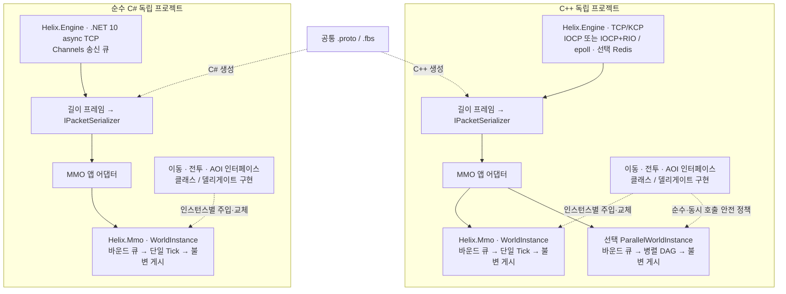

# MMO 인스턴스 기능 조립

> 갱신일: 2026-11-04

`cpp/Helix.Mmo`와 `csharp/Helix.Mmo`는 각각 네트워크 엔진과 독립인 시뮬레이션 라이브러리다. C++/C#이 서로 호출하지 않으며 별도 개발·빌드·검증을 유지한다. 아래 계약은 기존 `WorldInstance` 기준이다. C++ 선택 `ParallelWorldInstance`는 한 tick 내부의 여러 writer와 별도 단계별 규칙을 제공하며 [병렬 MMO 실험](PARALLEL_MMO.md)에 설명한다.

## 계약

| 역할 | 계약 |
|---|---|
| IMovementPolicy | 현재 엔티티/요청/불변 엔티티 뷰에서 새 위치 또는 거부를 반환 |
| ICombatRules | 공격자/대상/요청/불변 뷰에서 비음수 피해량 또는 거부를 반환 |
| IVisibilityPolicy | 불변 뷰에서 observer가 볼 엔티티 ID를 선정. 동시 조회에 안전해야 함 |
| WorldInstance | 엔티티 소유, 명령 큐, tick 경계 교체, 상태 검증/적용, 불변 게시 |

네트워크 콜백은 Queue*만 호출한다. 요청 거부와 큐 초과는 다르다: Queue*의 false는 큐 초과, TickResult의 Rejected는 대상/규칙/한도/규칙 예외로 인한 거부다. QUEUED 응답은 실제 적용 완료가 아니다.

Replace*는 인스턴스별 pending 슬롯에 새 구현을 저장한다. 마지막 요청이 다음 tick 시작에 적용된다. 이미 실행 중인 tick에는 영향을 주지 않는다. tick 중 들어온 명령은 다음 tick에서 처리한다. 동시에 또는 재진입하여 Tick을 호출하면 오류다.

조회는 마지막으로 완료한 tick의 게시 스냅샷을 읽는다. AOI 조회는 같은 게시 객체의 데이터와 규칙을 잡고, self/중복/존재하지 않는 ID를 필터링한다. 호출 중 교체되더라도 잡아둔 이전 구현의 수명이 보장된다. 조회/정책 context의 데이터는 직접 수정하거나 유효 범위 밖으로 참조 보관하지 않는다.

정책을 여러 인스턴스에서 공유할 때는 구현과 델리게이트 캡처의 동시성을 호출자가 보장해야 한다. C++은 shared_ptr가 정책 수명을 관리하며, C#은 참조 수명으로 보장한다. C# 정책의 IDisposable 자원을 월드가 자동으로 파괴하지 않으므로 외부 소유자가 진행 중 조회 종료를 확인한 뒤 정리해야 한다. 월드 파괴 전에 tick/조회 작업을 종료한다.

## C# 사용

```csharp
var world = new WorldInstance(1, limits, new WorldBehaviors(movement, combat, visibility));
world.ReplaceCombat(new DelegateCombatRules(context => 10));
world.QueueAttack(new AttackRequest(attackerId, targetId));
TickResult result = world.Tick();
```

클래스를 직접 구현해 주입해도 동일하다. 규칙은 결과를 계산하며 이동/HP의 실제 변경은 월드가 수행한다.

## 샘플 프로토콜

길이 헤더는 4바이트 big-endian이고 payload는 공통 `protos/helix_mmo.proto`의 Protobuf다. 양쪽 `Helix.Protocol`이 생성 코드를 소유하며 엔진/월드 라이브러리는 Protobuf에 의존하지 않는다. 접속 직후 `ServerPacket.welcome`으로 entity/world ID를 받는다. 샘플은 홀수 세션을 필드(1), 짝수 세션을 투기장(2)에 배치한다.

- `ClientPacket.move` → reply의 QUEUED / BUSY / INVALID.
- `ClientPacket.attack` → 큐 접수 여부. 필드는 공격 거부, 투기장은 예제 피해량 10.
- `ClientPacket.look` → 위치/HP/가시 ID/tick의 WorldState / PENDING.
- protocol_version=1, request_id는 응답에서 보존한다. 파싱 실패는 request_id=0 INVALID. 추가 unknown field는 허용하되 알 수 없는 명령/버전, 0 대상, 누락/비유한 좌표는 거부한다. 클라이언트가 자신의 entity ID를 지정하지 않고 세션에서 결정한다.

request_id는 중복 요청 실행 방지나 인증을 제공하지 않는다. WorldState의 위치/HP/tick은 한 Snapshot이며 VisibleTo는 별도 게시 뷰 조회이므로 tick 경계에서 가시 결과는 다음 tick일 수 있다. 원자적 전체 응답이 필요하면 월드의 통합 조회 계약을 별도로 확장한다.

이는 조립/계약 검증용 예제다. 인증·공간 충돌·고밀도 AOI·접속 재개·영속 데이터는 구현하지 않았다. 샘플 OnDisconnect에서 큐가 가득 차면 제거 실패를 로그로 보고한다. 운영 앱은 생명주기 명령 재시도/수락 제한을 설계해야 한다.

## 범위와 검증

C++ TCP/KCP/Redis 기존 기능은 유지한다. 순수 C#은 TCP/로컬 세션이 1차 범위이며 미구현 전송이나 cluster 설정은 오류로 보고한다. C#은 IServerTransport/ISessionTransport를 외부 구현으로 주입할 수 있다. C ABI는 C++의 선택 빌드이고 C#이 사용하지 않는다.

기본 `WorldInstance`는 명령 평가에 엔티티 뷰를 복사한다. C++ 게시 뷰의 ID 조회는 정렬 벡터 lower_bound, C# 조회/가시성 필터는 선형 탐색이다. 기본 샘플 AOI는 전체 엔티티를 순회한다. 대규모 동접 성능을 검증한 구현은 아니다. C++ 선택 `ParallelWorldInstance`에는 공간 인덱스와 배치 처리를 별도로 추가했지만 현재 단순 규칙의 속도 향상은 확인하지 못했다. [측정과 한계](PARALLEL_MMO.md)를 참고한다.

## 현재 구조



양쪽 프로젝트는 런타임/바이너리를 공유하지 않는다. 계약과 테스트 시나리오를 맞추고 QUIC은 후순위로 유지한다.

`ctest`의 world-instance와 `csharp/tests/Helix.Tests`는 인스턴스 격리, 클래스/델리게이트 계약, 세 기능 교체, tick 중 교체, 바운드 큐, 실패 규칙, 불변 스냅샷을 확인한다. 관리 엔진 테스트는 분할/합친 프레임, 두 헤더/엔디안, 과대 패킷 차단, 종료 콜백, 설정 우선순위와 외부 전송 주입도 확인한다. `tools/verify_engines.py`는 두 언어의 echo/churn과 `world_bot.py` 공통 프로토콜을 실행한다.


직렬화는 공통 메시지 DTO와 주입 IPacketSerializer로 선택한다. 기본 Protobuf와 공통 FlatBuffers, C# MemoryPack의 wire/버전/생성/검증은 [SERIALIZATION.md](SERIALIZATION.md)를 따른다. 이동·전투·AOI 인터페이스는 직렬화 라이브러리를 알지 않는다.
