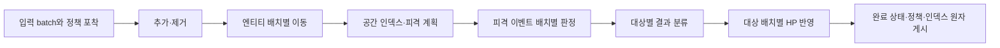

# 선택 실험: C++ 작업 그래프 병렬 월드

> 갱신: 2026-11-04 · C++ 선택 모듈. C#은 별도 구현·계획·검증을 유지한다. 측정일은 2026-11-03이다.

범용 네트워크 엔진에 붙이는 콘텐츠 처리 실험이다. 이 문서의 tick·전투·AOI 규칙은 해당 예제 월드에 적용한다. 엔진을 사용하는 앱은 자체 콘텐츠와 처리 구조를 구성한다.

## 목적과 실행

`ParallelWorldInstance`는 한 전장의 이동·공격 판정·서로 다른 대상의 HP 갱신을 여러 worker가 실행하도록 한다. 기존 `WorldInstance`는 명령 순차 적용의 비교/호환 경로다. 두 경로의 게임 규칙이 완전히 같은 것은 아니다. 병렬화 비교는 **동일한 새 단계별 규칙**을 순차 executor와 Taskflow executor에서 실행한다.

```powershell
cmake --preset windows-x64 -DHELIX_BUILD_PARALLEL_MMO=ON
cmake --build --preset windows-release --parallel 8
ctest --test-dir build/windows-x64 -C Release --output-on-failure
$env:HELIX_MMO__EXECUTION="parallel"
./build/windows-x64/Release/helix_world_server.exe config/helix.toml
```

설정은 기본값 → 파일 → `HELIX_MMO__*` 환경변수 순서다. `execution=parallel`인데 선택 모듈을 빌드하지 않았으면 샘플이 기동을 거부한다. 기본 실행은 기존 `sequential`이다. 기동 후 worker 구성 hot reload는 지원하지 않는다.

| `[mmo]` 설정 | 기본값 | 실제 소비 |
|---|---:|---|
| execution | sequential | C++ 샘플 조립에서 기존/병렬 월드 선택 |
| worker_threads | 4 | 프로세스에서 공유하는 Taskflow worker 수, 양수 |
| batch_size | 128 | 엔티티 작업 배치 크기, 양수 |
| cell_size | 16.0 | XZ 공간 인덱스 셀 크기, 유한 양수 |
| visibility_radius | 50.0 | AOI 후보의 3차원 거리, 유한 0 이상 |
| max_hits_per_tick | 65536 | 이번 tick에 계획하는 전체 피격 이벤트 수, 양수 |

I/O worker 수는 별도 `network.io_threads`다. 콘텐츠 worker와 합쳐 사용 가능한 CPU를 고려한다. 월드마다 별도의 풀을 만들지 않고 `shared_ptr<IWorldExecutor>`를 주입해 공유한다. 샘플 ticker는 여전히 Field와 Arena를 순서대로 호출하며, **한 월드 내부에서** 병렬 계산한다. tick 처리 후 `tick_ms`만큼 기다리는 기존 샘플 루프이므로 정확한 고정 주기/실시간 deadline 보장은 아니다.

## 단계와 동시 갱신



이동 단계의 여러 작업은 `moved` 배열의 서로 다른 엔티티 슬롯을 동시에 쓴다. HP 반영 작업도 `next` 배열의 서로 다른 슬롯을 동시에 쓴다. 한 월드 전체의 상태 변경을 한 worker에 묶지 않는다. DAG 선행 작업 완료가 다음 단계의 데이터 가시성을 보장한다. 데이터 구조의 resize/생성/삭제는 관련 작업이 실행 중일 때 수행하지 않는다.

- 한 월드의 `Tick()` 호출은 동시에 하나만 허용한다. atomic gate로 겹치는 호출과 같은 스레드의 재진입을 거부한다. 이는 tick 조정의 배타성이며 내부 상태 writer가 하나라는 뜻이 아니다.
- 추가/제거 명령은 해당 batch 안의 입력 순서대로 먼저 적용한다. 그다음 이동, 그다음 공격이다. 원래 명령 간 단계 교차 순서를 보존하는 모드는 아니다.
- 같은 엔티티의 여러 이동은 입력 순서대로 처리한다. `MovementContext.entity`에는 직전 이동 결과가 반영되며 `entities`는 lifecycle 완료 시점의 불변 뷰다. 다른 엔티티의 이번 이동 결과를 중간에 읽지 않는다.
- 공격 판정은 모든 이동이 끝난 동일 상태를 읽는다. 이 단계 시작 때 살아 있던 공격자들의 공격은 같은 tick의 다른 공격으로 사망해도 판정한다. 상호 처치가 가능하다.
- 단일 공격과 광역 공격 모두 주입된 `ICombatRules`를 피격 대상별로 호출한다. 광역기는 유한 center/radius, 0 이상 radius를 요구하며 시전자와 사망한 대상을 제외한다. radius 0은 같은 위치의 대상에 적용한다. 사거리/자원/진영 검사는 별도 게임 규칙이다.
- `QueueAreaAttack`은 C++ 도메인 API이며 기존 MMO 샘플의 공통 wire에는 광역 명령을 추가하지 않았다. 통신 smoke는 기존 이동·단일 공격·조회 계약을 검사하고 광역기는 도메인 테스트와 benchmark에서 검사한다.
- 피격 이벤트는 명령 순서와 대상 ID 순서로 계획한다. `max_hits_per_tick`을 초과할 명령은 전체 거부한다. 앞 명령이 예약한 hit가 나중에 규칙에서 거부돼도 예약 예산을 재사용하지 않는다. 일부 대상만 잘리는 광역기는 만들지 않는다.
- 피해량이 유효한 이벤트를 같은 대상에 대해 입력 순서로 반영한다. HP는 0으로 제한한다. 판정이 유효하면 이미 HP가 0이 된 대상의 후속 이벤트도 접수 성공으로 센다. 광역 명령은 유효한 hit가 하나 이상이면 applied다.
- 회복·버프·흡혈·반사·이동 충돌·드롭 소유권·영속 상태는 이번 실험에 없다. 이런 규칙은 단계와 이벤트 순서를 먼저 정의하고 추가한다. 단순 피해량 합산이 모든 전투 규칙을 대체한다고 가정하지 않는다.

## 정책·조회·실패 계약

병렬 월드의 이동·전투 정책과 delegate 캡처는 **순수·결정적·동시 호출 안전**이어야 한다. 전역 RNG나 호출 순서에 의존하는 가변 캡처를 쓰지 않는다. 기존 순차 정책을 그대로 병렬 호출해도 안전하다는 뜻이 아니다. `Replace*`는 다음 tick 시작에 포착되고 진행 중인 작업은 기존 정책 참조를 유지한다.

정책 예외/유효하지 않은 결과는 해당 명령 또는 hit만 거부한다. executor/할당 등 기반 작업 실패는 batch를 소비하고 예외를 전파하며, 이전 게시 스냅샷을 유지한다. 자동 재시도나 exactly-once 처리가 아니다. 사용자 규칙의 외부 부수효과는 rollback하지 않으므로 정책의 순수성이 필요하다.

executor는 반환/예외 전파 전에 시작된 모든 작업을 회수해야 한다. 같은 executor를 그 작업 안에서 재귀 호출하거나 다른 월드 tick을 기다리는 사용은 지원하지 않는다. 종료 시 새 tick을 중단하고 진행 중 tick/조회를 끝낸 뒤 월드와 executor를 정리한다.

조회는 마지막 완료 상태를 읽는다. `VisibleTo`는 같은 게시 객체의 snapshot·policy·index를 유지한다. XZ 셀로 후보를 찾고 XYZ 거리로 검사한 뒤 가시성 정책에 **정렬된 후보 엔티티 뷰**를 전달한다. 정책은 후보 밖의 ID를 추가할 수 없다. 자기 자신/중복/미존재 ID를 제거한다. 공간 인덱스는 int32 셀 범위를 사용하므로 범위 밖 위치의 Add/Move/정책 결과는 거부한다. 매우 큰 반경은 전체 엔티티 거리 검사로 전환해 셀 열거 폭증과 정수 변환 overflow를 피한다.

현재 `VisibleTo` 자체와 응답 직렬화는 호출 스레드에서 실행한다. 모든 관찰자의 AOI/패킷 생성을 DAG로 병렬화한 구현은 아니다. 샘플 `Snapshot()`과 `VisibleTo()`도 별도 호출이므로 응답의 tick 경계 혼합에 관한 [기존 한계](MMO.md)는 유지한다.

## 실행기 선택과 조사한 라이브러리

2026-11-03 공식 자료 확인 기준이다. 다음은 게임 엔진을 요구하지 않는 C++ 라이브러리이며 MMO 상태 충돌을 자동으로 해결하지 않는다.

| 라이브러리 | 기능과 선택 판단 |
|---|---|
| [Taskflow](https://github.com/taskflow/taskflow/releases/tag/v4.1.0) | C++20 작업 그래프·work stealing·병렬 알고리즘. 단계 의존성을 코드로 드러내기 쉬워 첫 adapter로 선택. 4.1.0 commit `45366fe5bc4f2f8ec9aa590b40c504e296886865` 고정 |
| [oneTBB](https://uxlfoundation.github.io/oneTBB/main/tbb_userguide/attach_flow_graph_to_arena.html) | parallel algorithms·flow graph·task_arena 동시성/하드웨어 제약. 실행 자원 제어가 필요할 때 비교 후보 |
| [enkiTS](https://github.com/dougbinks/enkiTS) | 가벼운 데이터/작업 병렬 실행·명시적 의존성·thread-pinned task·커스텀 allocator. 배치 스케줄링 비용을 줄일 때 비교 후보 |
| [Marl](https://github.com/google/marl) | thread/fiber 혼합 실행기. 공식 저장소가 2026-04-27 archive 상태여서 첫 의존성으로 선택하지 않음 |

공개 `IWorldExecutor::Execute(span<WorldTask>)`에 Taskflow 타입을 노출하지 않는다. 순차 adapter는 그래프의 위상 순서로 실행하는 정확성/비용 비교 기준이다. Taskflow adapter는 같은 그래프를 프로세스 공용 pool에서 실행한다. 라이브러리 간 성능 비교는 아직 수행하지 않았다. 설치 소비자는 `helix::mmo_parallel`을 링크하며 Taskflow 헤더를 설치할 필요가 없고 원 라이선스는 설치물에 포함한다.

## 검증과 측정 재현

```powershell
# 독립 C++/오프라인 도메인 구성 (Taskflow 최초 복원에는 네트워크 필요)
cmake -S cpp -B build/parallel -DHELIX_BUILD_PROTOCOL=OFF -DHELIX_BUILD_PARALLEL_MMO=ON
cmake --build build/parallel --config Release --parallel 8
ctest --test-dir build/parallel -C Release --output-on-failure
# C# 빌드 없이 Python Protobuf 클라이언트로 두 native 실행 모드 확인
python tools/verify_parallel_world.py --backend iocp_rio
# 빌드와 테스트가 끝난 뒤 순차 측정
python tools/parallel_world_benchmark.py
```

Python 통신 도구는 기존 `build/protobuf-python` runtime과 일치하는 protoc가 필요하다. [빌드 가이드](BUILD.md)의 Python 준비 절차를 따른다. `verify_parallel_world.py`는 자체 localhost 프로세스만 생성/종료한다. Windows terminate 정리는 graceful shutdown 증거가 아니다.

`parallel-world` CTest는 worker 1/2/4/8의 동일 단계 결과, 같은 월드의 실제 겹치는 정책 실행, 공유 executor의 다중 월드, 동시 snapshot/AOI reader, 교체 시점, 상호 처치, 광역기 예산, 설정 파일/env·잘못된 값, 실패 시 미게시를 확인한다. 공간 질의는 worker끼리의 일치뿐 아니라 독립적인 전체 거리 검사와 대조한다.

측정 도구는 분산/밀집/보스 집중 공격을 inline/Taskflow 1/2/4/8 worker에서 같은 입력으로 실행한다. 매 run의 최종 hash·적용/거부·가시 ID 개수를 대조한다. warmup·반복·batch·셀·반경·hit 예산은 CLI/생성 설정 파일로 남기고 HELIX 환경변수는 자식 프로세스에서 제거한다. 빌드/다른 부하와 겹쳐 실행하지 않는다.

tick 시간은 lifecycle·복사·index·DAG 구축/검증·판정·대상 분류/반영·게시를 포함한다. 입력 enqueue, network, 외부 I/O, 별도 AOI 질의는 제외하며 AOI는 따로 기록한다. `out/parallel-world/raw.csv`, `results.json`, `report.md`에 원시 결과와 조건을 보존한다. run별 percentile의 중앙값은 전체 표본을 합친 percentile이 아니다. 이 작은 도메인 측정에서 운영 MMO 수용 인원을 추정하지 않는다.

## 2026-11-03 최종 검증과 기준 측정

Windows x64 Release의 전체 CTest 6/6, Protocol OFF 독립 C++ 구성 4/4, 선택 모듈 OFF의 기존 월드 테스트를 통과했다. 최종 소스로 재설치한 SDK의 외부 CMake 소비자는 Taskflow 헤더 없이 빌드·실행했다. Python 클라이언트의 실제 IOCP/RIO 통신은 기존 순차·병렬 서버 모두 통과했다. C#은 이번 검증에서 빌드하지 않았다. Linux·원격 CI·TSan은 미실행이다.

최종 바이너리는 `python tools/parallel_world_benchmark.py --out out/parallel-world-final`로 측정했다. 엔티티 4,096개, warmup 10 ticks, 측정 100 ticks, 3 runs이며 배치 128·셀 크기 4·가시거리 10·광역 반경 0.15·hit 예산 131,072를 사용했다.

| 시나리오 | inline tick p99 µs | Taskflow 4 workers tick p99 µs |
|---|---:|---:|
| 분산 전투 | 2,128.5 | 2,387.7 |
| 한 지점 밀집 | 3,276.2 | 3,363.9 |
| 보스 집중 공격 | 1,107.5 | 1,261.4 |

표는 run별 p99의 중앙값이다. inline과 worker 1/2/4/8의 45개 측정에서 최종 hash·적용/거부·가시 ID 수가 일치했다. 로컬 조건과 변동 폭은 `out/parallel-world-final/report.md`·`raw.csv`·`results.json`에 있다. 이 생성물은 Git에 포함하지 않으며 clone 후 위 명령으로 생성한다. 앞선 로컬 `out/parallel-world` 측정도 보존한다.

**현재 단순 규칙에서는 병렬 실행의 성능 개선을 확인하지 못했다.** 같은 월드의 동시 갱신과 결과 일치는 확인했다. 직렬 공간 인덱스·피격 계획·대상 분류와 스케줄링 비용이 남아 있지만 단계별 계측 전에는 어느 구간이 주 병목인지 단정하지 않는다. 다음 성능 작업은 단계별 시간·할당 계측을 먼저 추가하고, 실제 콘텐츠 규칙과 더 큰 입력에서 배치 크기·인덱스·작업 그래프 재사용을 비교하는 것이다.
