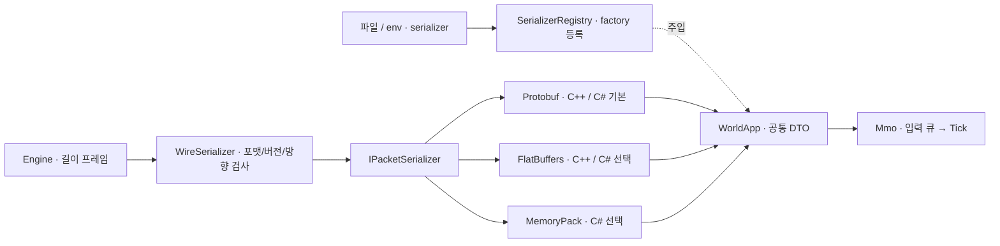

# 예제 메시지의 직렬화

갱신: 2026-11-04. `Helix.Protocol`은 이 저장소의 MMO 예제용 메시지와 직렬화 adapter를 제공한다. 엔진 코어는 프레이밍된 바이트를 전달하며, 앱은 사용할 메시지 형식과 codec을 정한다. 아래 계약은 이 예제 메시지를 사용할 때 적용한다. 기본은 기존 Protobuf wire이며 선택 포맷은 공통 DTO 의미를 유지한다.

| 포맷 | C++ | C# | 적용 경로 |
|---|---|---|---|
| protobuf (ID 1) | 지원 | 지원 | 기본 Helix.Protocol, 기존 클라이언트 호환 |
| flatbuffers (ID 2) | 지원 | 지원 | 선택 Helix.Protocol.FlatBuffers |
| memorypack (ID 3) | 미지원 | 지원 | 선택 Helix.Protocol.MemoryPack, little-endian C#끼리 |

## Unity·Unreal 공통 클라이언트 전제

C++·C# 서버 엔진은 독립 프로젝트다. 클라이언트는 Unity 또는 Unreal이 될 수 있으므로 서버 언어에 관계없이 같은 외부 메시지 schema·버전·framing을 사용한다.

- 공통 기본: Protobuf. 공통 `.proto`에서 클라이언트 언어별 코드를 생성한다.
- 공통 선택 최적화: FlatBuffers. `.fbs`·envelope를 양쪽에서 맞추고 엔진별 Player/Shipping에서 확인한다.
- MemoryPack: C# 전용 최적화 경로. Helix C++ adapter가 없으므로 Unity·Unreal 공통 필수 wire로 선택하지 않는다.

현재 `net10.0` 관리 NuGet은 서버용이며 Unity에 그대로 넣어 사용하는 SDK로 검증되지 않았다. Unity의 지원 API/C#·Mono/IL2CPP를 위한 클라이언트 코드와 Unreal 모듈/대상 toolchain을 위한 client SDK는 별도 구성·검증 대상이다. 양 언어 codec 교차 검증은 게임 엔진 통합 성공을 뜻하지 않는다.

MemoryPack 자체는 Unity를 지원하지만 고정 버전 1.21.4 공식 문서는 CustomFormatter 제약 및 일부 .NET/Unity binary 차이를 안내한다. 현재 adapter는 custom bounded formatter를 사용하므로 이 상태를 Unity 지원 완료라고 표기하지 않는다. [공식 Unity 제약](https://github.com/Cysharp/MemoryPack/blob/1.21.4/README.md#unity), [Unity API 호환 수준](https://docs.unity.com/en-us/engine/6000.7/manual/programming-environment/overview-of-dot-net-in-unity/dotnet-profile-support).

성능 표는 .NET 10/MSVC 구현 결과로 유지하며 실제 Unity IL2CPP·Unreal 빌드에서 측정하기 전 해당 클라이언트의 성능으로 일반화하지 않는다. wire header의 direction 바이트는 ClientPacket/ServerPacket 구분이며 C++/C# 프로젝트 결합을 뜻하지 않는다.

## 책임과 주입

- `messages.h` / `Messages.cs`: Move·Attack·Look·Welcome·Reply·State 및 ClientPacket/ServerPacket. 라이브러리 생성 타입과 MMO 상태를 포함하지 않는다.
- `IClientPacketSerializer`는 요청 encode/응답 decode, `IServerPacketSerializer`는 요청 decode/응답 encode만 노출한다. 양쪽 adapter는 두 역할을 합친 `IPacketSerializer`를 구현한다. 호출별 소유 bytes/DTO를 만들고 상태를 공유하지 않는다. decode는 파싱이며 의미 검증은 `messages::IsValid` / `MessageContract.IsValid`가 맡는다.
- Protobuf/FlatBuffers/MemoryPack adapter: 공통 DTO ↔ 포맷별 생성 타입. 서로 다른 adapter를 사용해도 uint64 요청/엔티티/tick, double 좌표, int32 HP, AOI ID 배열 의미가 같다.
- `SerializerRegistry`: 조립 시 factory 등록. 새 구현은 고유 name/ID와 factory로 추가한다. 미등록 이름·중복 name/ID·factory의 ID 위반은 실패한다. 등록 완료 뒤 공유하고 실행 중 registry 수정은 지원하지 않는다.
- `WireSerializer`: 포맷 메타데이터를 감싸고 검사한다. 네트워크 framing이나 월드 기능을 담당하지 않는다.
- WorldApp: 좁은 `IServerPacketSerializer`를 생성자 주입받아 도메인 큐/조회와 연결한다. Engine은 바이트 프레임, Mmo는 도메인만 처리한다.



## 선택

```toml
[protocol]
serializer = "protobuf" # flatbuffers 또는 C# memorypack
```

`HELIX_PROTOCOL__SERIALIZER`가 파일을 덮어쓴다. core config는 이름을 보관하고 빈 이름을 거부하며, 등록/지원 여부는 앱 조립 지점에서 검사한다. 서버 시작 전에 확정하고 연결 동안 유지한다. 세션 중간 자동 협상·포맷 전환은 구현하지 않았다. C++에 memorypack을 지정하거나 FlatBuffers OFF 빌드에서 flatbuffers를 지정하면 기동 실패다.

C#:

```csharp
using Helix.Protocol;
using Helix.Protocol.FlatBuffers;
using Helix.Protocol.MemoryPack;
using Helix.Protocol.Messages;
var registry = new SerializerRegistry();
registry.RegisterFlatBuffers();
registry.RegisterMemoryPack();
IPacketSerializer codec = registry.Create("flatbuffers"); // 생략하면 protobuf
byte[] bytes = codec.EncodeClient(new ClientPacket(1, 42, new Look()));
if (codec.TryDecodeClient(bytes, out var packet) && packet is not null && MessageContract.IsValid(packet)) { /* route */ }
```

C++:

```cpp
#include <helix/protocol/flatbuffers_serializer.h>
helix::protocol::SerializerRegistry registry;
helix::protocol::RegisterFlatBuffers(registry);
auto codec = registry.Create("flatbuffers"); // 생략하면 protobuf
std::string bytes;
codec->EncodeClient({ 1, 42, helix::protocol::messages::Look{} }, bytes);
```

기본 C++ 빌드는 선택 adapter를 제공한다. `HELIX_BUILD_FLATBUFFERS=OFF`로 제외할 수 있고, `HELIX_BUILD_PROTOCOL=OFF`는 Protobuf/FlatBuffers 모두 제외한다. 외부 CMake 소비자는 `helix::protocol_flatbuffers`를 링크한다. Google 헤더는 이 adapter의 공개 헤더에 나오지 않으며 설치된 adapter는 외부 FlatBuffers runtime 링크가 필요 없다. 기본 Helix.Protocol에는 기존 Protobuf 공개 API 호환을 위해 Google.Protobuf 의존성이 남는다. Engine/Mmo에는 serializer 패키지 의존성을 추가하지 않았다.

관리 패키지는 0.4.0이다. 기본 `Helix.Protocol`에 선택 패키지 두 개를 필요한 만큼 추가한다. 기존 0.3.0 패키지/기록은 보존한다.

## 호환 범위와 wire

포맷끼리 바이트가 호환되는 것은 아니다. 송신자/수신자가 같은 포맷, envelope revision, 메시지 버전을 사용해야 한다. 같은 DTO의 의미가 같으므로 앱에서 디코딩 후 다른 codec으로 다시 인코딩할 수는 있다. 자동 transcoding은 하지 않는다.

- TCP 샘플 바깥 framing: 4바이트 big-endian 길이. 길이는 아래 payload 전체를 포함한다.
- protobuf: 기존 raw Protobuf payload 그대로. 기존 `.proto` 클라이언트는 수정할 필요가 없다.
- flatbuffers/memorypack: 8바이트 header + 해당 binary payload.

| offset | 내용 |
|---|---|
| 0..3 | ASCII `HXS1` |
| 4 | format ID: 2 FlatBuffers, 3 MemoryPack; 0 예약 |
| 5 | envelope/schema revision: 1 |
| 6 | direction: 1 ClientPacket, 2 ServerPacket |
| 7 | reserved: 0 |

미등록 포맷/잘못된 메타데이터는 다른 codec으로 추측해서 읽지 않는다. 샘플 서버는 선택 포맷으로 request_id=0 INVALID를 응답한다. 수신 codec이 맞지 않는 클라이언트도 이를 성공 응답으로 해석할 수 없다. 파싱된 잘못된 버전·비유한 좌표·0 대상은 기존처럼 request ID를 유지하고 INVALID다. 이 식별자는 인증이나 암호화 기능이 아니다.

Client body는 Move/Attack/Look, Server body는 Welcome/Reply/State다. body 종류와 ReplyStatus 숫자 0..4는 고정한다. QUEUED는 tick 적용 전 접수이며 request ID는 중복 실행 방지 기능이 아니다.

## 스키마와 변경

- Protobuf: `protos/helix_mmo.proto`, protoc/runtime 36.2 정확히 일치. 필드 번호/타입을 유지하고 삭제 시 reserved. 추가 unknown field를 읽을 수 있다. 포맷 독립 DTO는 unknown field를 보관하지 않으므로 proxy의 byte-preserving forward용 계약은 아니다. 기존 generated 타입/PacketCodec API는 보존했다.
- FlatBuffers: `protos/helix_mmo.fbs`가 운영 정본, identifier `HXMP`, flatc/runtime 25.2.10. 필드 및 union 종류는 끝에 추가하고 기존 순서/타입/숫자를 바꾸지 않는다. 양 언어 모두 네트워크 입력을 verifier로 검사한 뒤 소유 DTO로 복원한다. view-only / zero-copy API를 제공하는 것이 아니다.
- MemoryPack: `MemoryPacket`에 VersionTolerant + 영구 MemoryPackOrder 0..13. 필드 추가는 새 order, 기존 타입/order 재사용 금지. 읽기 전에 member 길이 합·고정 필드 폭·AOI 배열 count를 실제 bytes와 대조하고 trailing bytes를 거부한다. 배열 formatter도 할당 전에 count를 검사한다. little-endian C# 전용이며 C++ 지원을 뜻하지 않는다.
- 의미가 깨지는 변경은 메시지 버전 또는 envelope revision을 올리고 양쪽 배포를 맞춘다. 모든 과거/미래 스키마에 대한 무조건 호환은 보장하지 않는다.

공식 문서: [FlatBuffers C# verifier/생성](https://flatbuffers.dev/languages/c_sharp/), [MemoryPack version tolerant](https://github.com/Cysharp/MemoryPack#version-tolerant).

```powershell
# 공식 같은 버전 flatc로 관리 생성 파일 재생성 (편집 금지)
./tools/generate_serialization_schema.ps1 -Flatc ./build/flatc/flatc.exe
cmake --preset windows-x64 -DHELIX_FLATC_EXECUTABLE=D:/tools/flatc.exe
cmake --build --preset windows-debug
```

C++ 생성 파일은 build 안, C# 생성 파일은 adapter의 Generated에 저장한다. flatc 경로를 생략하면 고정된 upstream source로 compiler를 빌드한다. benchmark의 `world_state.fbs`는 측정 전용으로 별도 유지한다. 운영 adapter는 verifier·envelope·VersionTolerant 및 DTO mapping을 포함하므로 과거 bare-state benchmark 배율을 그대로 적용하지 않는다.

## 검증

`ctest --test-dir build/windows-x64 -C Debug --output-on-failure`, 관리 `Helix.Tests.dll`, `python tools/verify_engines.py --native-backend iocp_rio`를 사용한다.

- 3 Client + 9 Server cases: uint64 최대값, int32 최소값, double 좌표, 모든 reply 상태, AOI 0/16/256/4096.
- C++ → C# 및 C# → C++ Protobuf/FlatBuffers fixtures. 서로 다른 binary layout이어도 동일 DTO 필드를 대조한다. C#에서 추가한 FlatBuffers 필드를 C++가 읽는다.
- C# 추가 MemoryPack member 읽기, 사용자 codec ID 42의 registry 등록/주입, 기존 raw Protobuf 및 누락 body request ID 유지.
- 메타데이터/방향/포맷 불일치, 잘린 payload, FlatBuffers verifier, MemoryPack 손상 배열 count·필드 길이, 작은 난수 corpus.
- 실제 C++ Protobuf/FlatBuffers + C# Protobuf/FlatBuffers/MemoryPack 서버의 이동·전투·AOI·request ID·잘못된 입력 및 기존 Python Protobuf 클라이언트. helper의 자체 서버 강제 종료는 graceful 종료 검증과 구분한다.

위 검증은 Windows 로컬 기능/호환 검증이다. 새 adapter의 Windows Release 시간·크기·할당량은 로컬 생성물 `out/wire-report.md`에서 별도 측정했다. 보고서는 Git에 포함하지 않으며 [헤더·검증 포함 측정 명령](BENCHMARKS.md#적용-codec의-헤더검증-포함-비교)으로 생성한다. Linux·원격 CI·운영 부하·실제 socket 비용은 별도 검증 대상이다.
